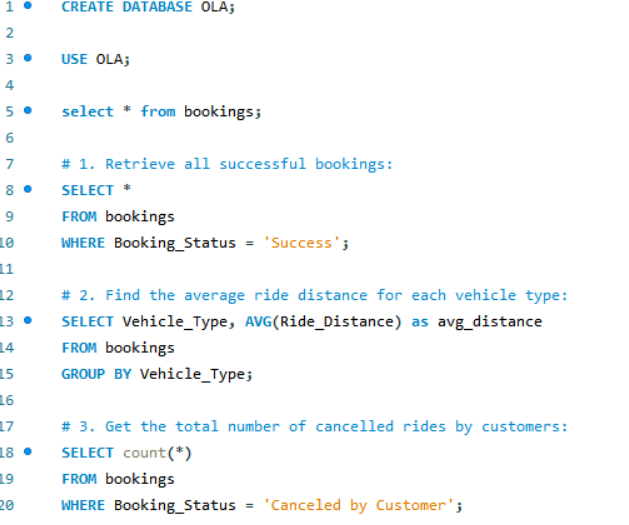
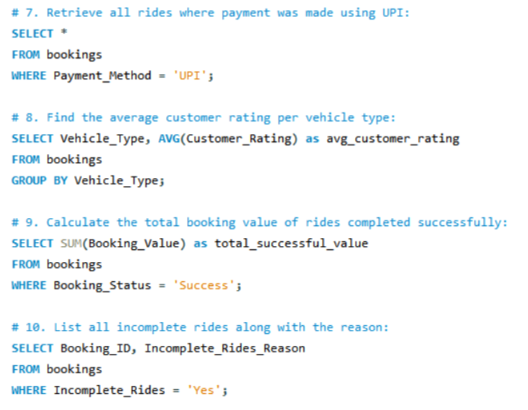
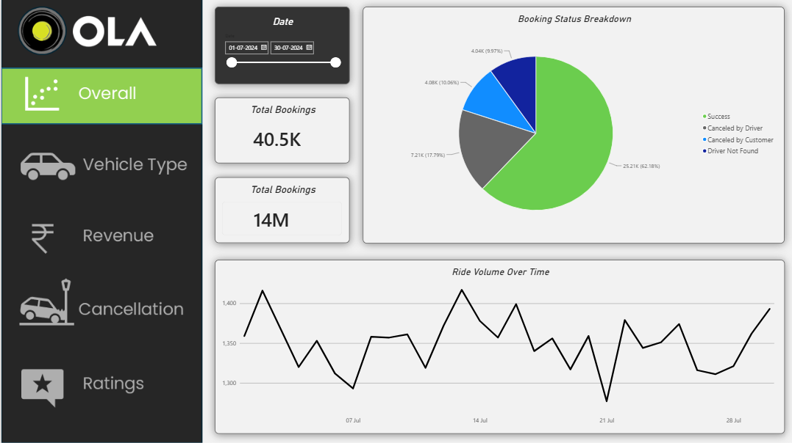
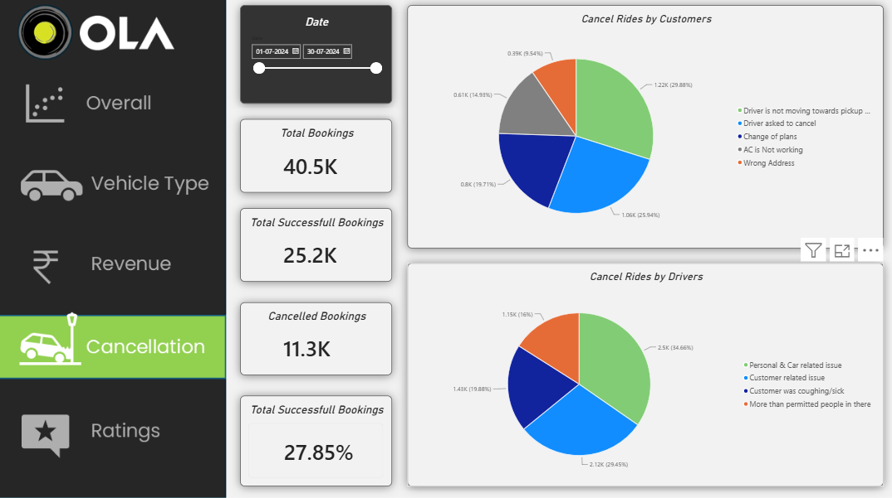
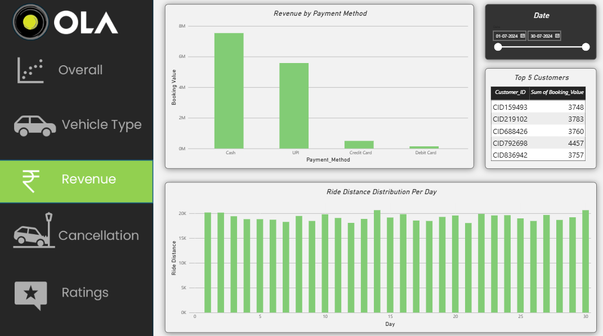
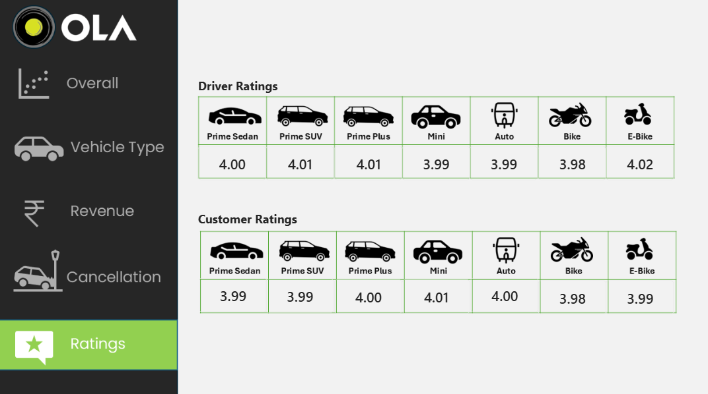

# 🚖 OLA Ride Booking Data Analytics Project | SQL, Excel & Power BI

## 📌 Project Overview

This project focuses on analyzing OLA ride-booking data to uncover meaningful business insights related to ride performance, customer behavior, cancellations, revenue, vehicle preferences, and ratings.

The project uses **SQL, Microsoft Excel, and Power BI** to perform data analysis, answer business questions, and build an interactive dashboard containing five report pages.

The analysis helps understand booking trends, identify cancellation patterns, evaluate vehicle performance, monitor customer satisfaction, and analyze revenue generated from successful rides.

## 🎯 Project Objectives

- Analyze ride-booking trends over time.
- Identify successful, cancelled, and incomplete bookings.
- Understand customer and driver cancellation patterns.
- Analyze ride distance across different vehicle types.
- Identify the top customers based on ride frequency and booking value.
- Evaluate customer and driver ratings.
- Analyze revenue by payment method.
- Build an interactive Power BI dashboard for business decision-making.
- Solve real-world business questions using SQL in MySQL Workbench.

## 🛠️ Tools & Technologies

| Tool | Purpose |
|---|---|
| MySQL Workbench | SQL queries, data analysis, and business problem-solving |
| Microsoft Excel | Data inspection, cleaning, formatting, and preliminary analysis |
| Microsoft Power BI | Interactive dashboards, KPIs, charts, and visual reporting |
| GitHub | Project documentation, version control, and portfolio presentation |

## 📂 Dataset Description

The dataset contains OLA ride-booking information, including booking details, customer and driver information, vehicle categories, pickup and drop locations, ride timings, cancellation reasons, booking value, ride distance, and ratings.

### Dataset Columns

| No. | Column Name | Description |
|---:|---|---|
| 1 | Date | Date of the ride booking |
| 2 | Time | Time of the ride booking |
| 3 | Booking ID | Unique identifier for each booking |
| 4 | Booking Status | Status of the booking |
| 5 | Customer ID | Unique identifier for each customer |
| 6 | Vehicle Type | Auto, Prime Plus, Prime Sedan, Mini, Bike, eBike, Prime SUV |
| 7 | Pickup Location | Ride pickup area in Bangalore |
| 8 | Drop Location | Ride destination selected from the location list |
| 9 | AvgVTAT | Average time taken by the driver to arrive at the vehicle/pickup point |
| 10 | Avg CTAT | Average time taken by the driver to arrive at the customer |
| 11 | Cancelled Rides by Customer | Indicates customer-cancelled rides |
| 12 | Reason for Cancelling by Customer | Customer cancellation reason |
| 13 | Cancelled Rides by Driver | Indicates driver-cancelled rides |
| 14 | Reason for Cancelling by Driver | Driver cancellation reason |
| 15 | Incomplete Rides | Indicates rides that were not completed |
| 16 | Incomplete Rides Reason | Reason for an incomplete ride |
| 17 | Booking Value | Monetary value of the booking |
| 18 | Ride Distance | Total distance travelled or recorded for the ride |
| 19 | Driver Ratings | Rating provided for the driver |
| 20 | Customer Rating | Rating provided by the customer |

**Note:** The pickup and drop locations use dummy location points representing 50 areas in Bangalore. These locations are synthetic and are intended for analytical practice.

### Cancellation Reasons

**Customer cancellation reasons**
- Driver is not moving towards the pickup location
- Driver asked to cancel
- AC is not working (four-wheelers only)
- Change of plans
- Wrong address

**Driver cancellation reasons**
- Personal & car-related issues
- Customer-related issue
- The customer was coughing/sick
- More than permitted people in the vehicle

**Incomplete ride reasons**
- Customer demand
- Vehicle breakdown
- Other issue

## 🔄 Project Workflow

1. **Data Preparation:** Inspect the dataset, validate columns, check missing values, and prepare data types.
2. **Excel Analysis:** Review the data, perform basic cleaning, and conduct preliminary analysis.
3. **SQL Analysis:** Use MySQL Workbench to answer business questions with filtering, aggregation, grouping, sorting, and ranking.
4. **Power BI Development:** Create measures, KPIs, charts, and interactive report pages.
5. **Business Insights:** Interpret booking trends, revenue, cancellations, ratings, and vehicle performance.
6. **Documentation:** Store SQL query screenshots and dashboard screenshots in GitHub.

## 🗄️ SQL Analysis — MySQL Workbench

The following 10 business questions were solved using SQL.

| No. | Business Question | Analysis Objective |
|---:|---|---|
| 1 | Retrieve all successful bookings. | Identify completed and successful rides. |
| 2 | Find the average ride distance for each vehicle type. | Compare distance performance by vehicle category. |
| 3 | Get the total number of cancelled rides by customers. | Measure customer cancellation volume. |
| 4 | List the top 5 customers who booked the highest number of rides. | Identify the most frequent customers. |
| 5 | Get the number of rides cancelled by drivers due to personal and car-related issues. | Analyze driver-related cancellation patterns. |
| 6 | Find the maximum and minimum driver ratings for Prime Sedan bookings. | Evaluate the rating range for Prime Sedan. |
| 7 | Retrieve all rides where payment was made using UPI. | Analyze bookings paid through UPI. |
| 8 | Find the average customer rating per vehicle type. | Compare customer satisfaction across vehicles. |
| 9 | Calculate the total booking value of rides completed successfully. | Calculate revenue from successful rides. |
| 10 | List all incomplete rides along with the reason. | Identify incomplete bookings and their causes. |

### 📸 SQL Query Screenshots

The SQL query screenshots are stored in the `Screenshots` folder.

**SQL Screenshot 1**



**SQL Screenshot 2**


**SQL Screenshot 3**



> Ensure the filenames in your repository match these image paths. If the second screenshot is named `SQLS2.png` rather than `SQLS@.png`, change the corresponding Markdown path to `Screenshots/SQLS2.png`.

## 📊 Power BI Dashboard

An interactive Power BI dashboard was developed to analyze booking performance, vehicle usage, cancellation behavior, revenue, and ratings.

The dashboard contains **five report pages**.

### 1. Overall Dashboard

Provides a high-level overview of ride-booking performance and booking trends.

**Key analysis**
- Ride volume over time
- Booking status breakdown
- Overall booking performance
- Top 5 vehicle types by ride distance



### 2. Vehicle Analysis Dashboard

Analyzes vehicle-category performance and ride distance.

**Key analysis**
- Top 5 vehicle types by ride distance
- Ride distance comparison across vehicle categories
- Vehicle usage and booking patterns


### 3. Cancellation Analysis Dashboard

Examines cancelled bookings and the reasons behind cancellations.

**Key analysis**
- Customer cancellation reasons
- Driver cancellation reasons
- Cancellation trends and patterns
- Identification of common cancellation issues



### 4. Revenue Analysis Dashboard

Focuses on booking value and revenue-related business insights.

**Key analysis**
- Revenue by payment method
- Top 5 customers by total booking value
- Booking value analysis
- Revenue contribution across payment categories



### 5. Ratings Analysis Dashboard

Evaluates customer satisfaction and driver performance.

**Key analysis**
- Average customer ratings by vehicle type
- Driver ratings distribution
- Customer ratings distribution
- Customer versus driver ratings



## 📈 Power BI Business Questions

The following 10 business questions were addressed through dashboard visualizations.

| No. | Business Question | Suggested Visualization |
|---:|---|---|
| 1 | Ride Volume Over Time | Line chart |
| 2 | Booking Status Breakdown | Donut chart or bar chart |
| 3 | Top 5 Vehicle Types by Ride Distance | Horizontal bar chart |
| 4 | Average Customer Ratings by Vehicle Type | Column chart |
| 5 | Cancelled Rides Reasons | Bar chart |
| 6 | Revenue by Payment Method | Column or bar chart |
| 7 | Top 5 Customers by Total Booking Value | Horizontal bar chart |
| 8 | Ride Distance Distribution Per Day | Column chart or line chart |
| 9 | Driver Ratings Distribution | Histogram or column chart |
| 10 | Customer vs. Driver Ratings | Scatter chart |

## 💡 Key Business Insights

The project is designed to help stakeholders answer questions such as:

- Which vehicle types contribute the most to total ride distance?
- How does ride volume change over time?
- What proportion of bookings are successful, cancelled, or incomplete?
- What are the most common reasons for customer and driver cancellations?
- Which customers generate the highest booking value?
- Which payment methods contribute the most revenue?
- Which vehicle categories receive the highest customer ratings?
- How are driver ratings distributed?
- Is there a relationship between customer ratings and driver ratings?
- Which operational issues could be addressed to improve ride completion?

*Actual findings should be added after reviewing the SQL query outputs and Power BI dashboard results.*

## 📁 Repository Structure

```text
OLA-Ride-Booking-Data-Analysis/
│
├── Screenshots/
│   ├── SQLS1.png
│   ├── SQLS@.png
│   ├── SQLS3.png
│   ├── Overall.png
│   ├── Vehicle.png
│   ├── Cancellation.png
│   ├── Revenue.png
│   └── Ratings.png
│
├── README.md
│
└── [Add your SQL scripts, Excel dataset, and Power BI file here]
```

> The SQL scripts, Excel dataset, and Power BI file should be added to the repository if you want visitors to download and reproduce the analysis. The filenames shown in brackets are placeholders, not existing files.

## 🚀 How to Explore the Project

1. Clone or download this repository.
2. Open the SQL scripts in MySQL Workbench and execute the queries against the prepared dataset.
3. Open the Excel dataset to review the source data and cleaning steps.
4. Open the Power BI `.pbix` file in Power BI Desktop.
5. Explore the five dashboard pages and interact with the available filters and visuals.
6. Review the screenshots to understand the SQL analysis and dashboard layout.

## 🎓 Skills Demonstrated

- SQL querying and business problem-solving
- Data cleaning and preparation
- Microsoft Excel data analysis
- Data aggregation and KPI analysis
- Power BI dashboard development
- Data visualization and storytelling
- Customer behavior analysis
- Revenue and booking analysis
- Cancellation and operational performance analysis
- Analytical reporting and documentation

## 👨‍💻 Project Information

**Project:** OLA Ride Booking Data Analytics

**Domain:** Ride-Hailing / Transportation Analytics

**Tools:** MySQL Workbench, Microsoft Excel, Power BI, GitHub

**Project Type:** End-to-End Data Analytics Portfolio Project


