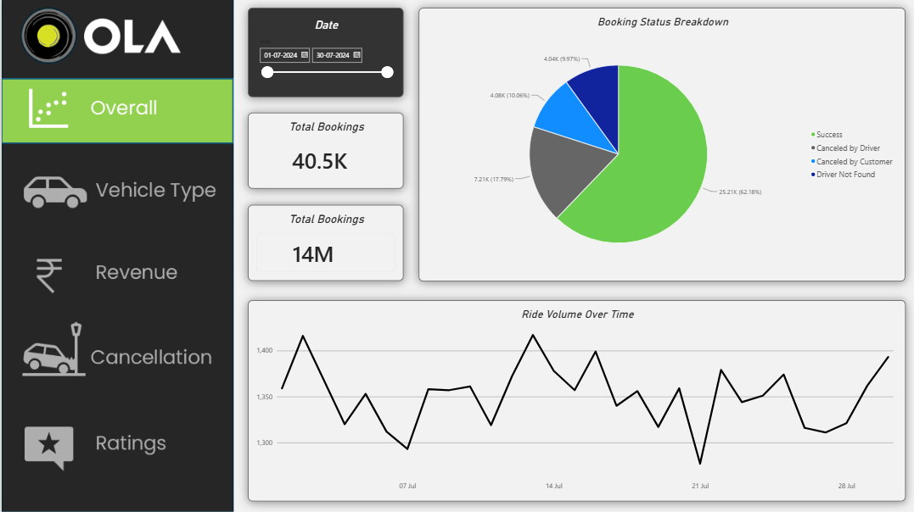
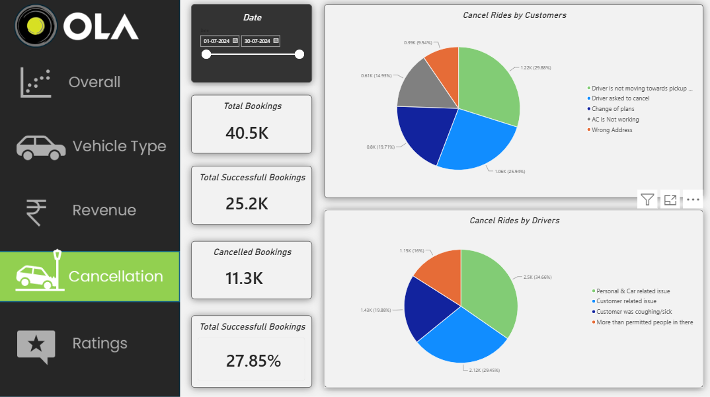
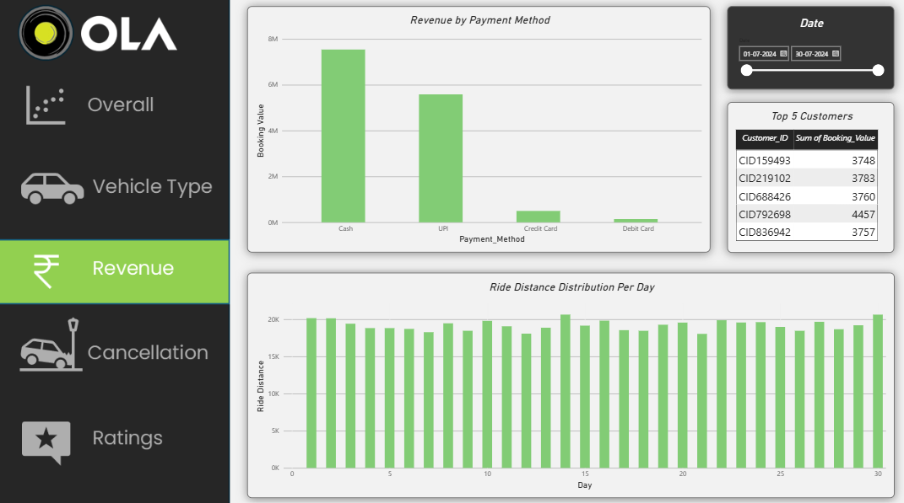
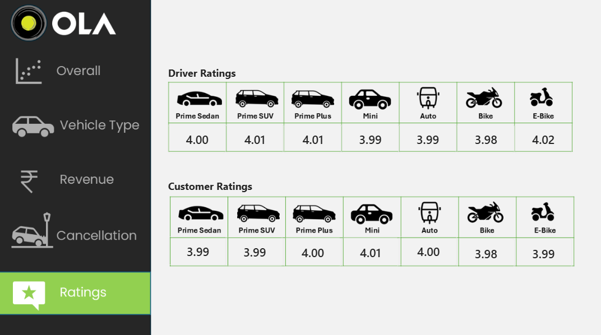
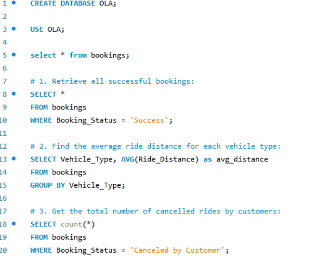
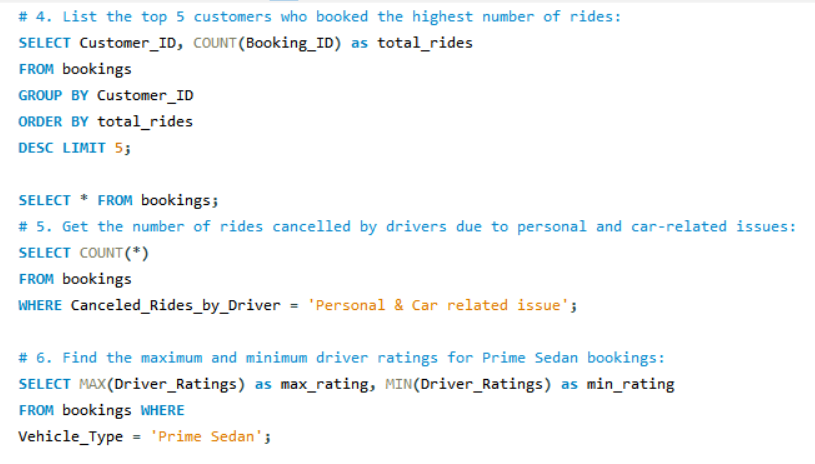
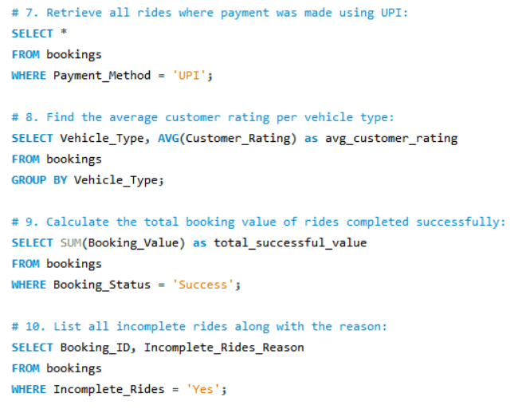

# OLA Ride Booking Data Analytics

**SQL | Excel | Power BI | Data Analytics**

An end-to-end data analytics project analyzing OLA ride booking data to understand booking performance, customer behavior, cancellations, revenue, vehicle performance, and customer satisfaction.

---

## Table of Contents

- [About the Project](#about-the-project)
- [Business Problem](#business-problem)
- [Business Questions](#business-questions)
- [Dataset Overview](#dataset-overview)
- [Project Structure](#project-structure)
- [Project Workflow](#project-workflow)
- [SQL Analysis](#sql-analysis)
- [Key Performance Indicators](#key-performance-indicators)
- [Power BI Dashboard](#power-bi-dashboard)
- [Dashboard Screenshots](#dashboard-screenshots)
- [SQL Query Screenshots](#sql-query-screenshots)
- [Key Insights](#key-insights)
- [Business Recommendations](#business-recommendations)
- [Tools and Technologies](#tools-and-technologies)
- [Limitations](#limitations)
- [Author](#author)

---

## About the Project

This project focuses on analyzing OLA ride booking data using SQL, Excel, and Power BI to identify business trends, evaluate operational performance, and generate actionable insights.

The analysis covers booking trends, successful and cancelled rides, vehicle performance, customer behavior, revenue generation, ride distances, and customer and driver ratings.

The project follows an end-to-end data analytics workflow, from data preparation and SQL analysis to KPI development and interactive dashboard creation.

---

## Business Problem

Ride-booking businesses operate in a dynamic environment where booking success, cancellations, customer satisfaction, driver performance, and revenue directly influence business performance.

The objective of this project is to analyze ride-booking data and identify patterns that can help the business:

- Improve successful ride completion rates
- Understand customer and driver cancellation patterns
- Identify high-performing vehicle categories
- Analyze revenue and payment trends
- Evaluate customer and driver ratings
- Improve operational efficiency
- Support data-driven business decisions

---

## Business Questions

The project addresses the following business questions:

- What is the overall booking volume?
- How many bookings were successfully completed?
- What is the cancellation rate?
- What are the primary reasons for customer and driver cancellations?
- Which vehicle categories generate the highest ride distance?
- Who are the top customers based on booking frequency and booking value?
- What is the total revenue generated from successful rides?
- Which payment methods are most frequently used?
- How do customer ratings vary across vehicle categories?
- What are the major reasons for incomplete rides?

---

## Dataset Overview

The dataset contains ride-booking information, including booking details, customer information, vehicle categories, ride status, cancellation details, revenue, ride distance, and ratings.

### Key Columns

| Column | Description |
|---|---|
| Date | Booking date |
| Time | Booking time |
| Booking ID | Unique booking identifier |
| Booking Status | Status of the booking |
| Customer ID | Unique customer identifier |
| Vehicle Type | Category of vehicle booked |
| Pickup Location | Ride pickup location |
| Drop Location | Ride destination |
| Avg VTAT | Average Vehicle Time of Arrival |
| Avg CTAT | Average Customer Time of Arrival |
| Customer Cancellation | Customer cancellation indicator |
| Customer Cancellation Reason | Reason for customer cancellation |
| Driver Cancellation | Driver cancellation indicator |
| Driver Cancellation Reason | Reason for driver cancellation |
| Incomplete Rides | Incomplete ride indicator |
| Incomplete Ride Reason | Reason for incomplete ride |
| Booking Value | Value of the booking |
| Ride Distance | Distance covered during the ride |
| Customer Rating | Customer rating |
| Driver Rating | Driver rating |

---

## Project Structure

```text
OLA-Ride-Booking-Data-Analysis/
│
├── Screenshots/
│   ├── SQLS1.png
│   ├── SQLS2.png
│   ├── SQLS3.png
│   ├── Overall.png
│   ├── Vehicle Type.png
│   ├── Cancellation.png
│   ├── Revenue.png
│   └── Ratings.png
│
├── SQL/
│   └── OLA_Ride_Booking_Analysis.sql
│
├── Dataset/
│   └── OLA_Ride_Booking_Data.xlsx
│
├── Power BI/
│   └── OLA_Ride_Booking_Analysis.pbix
│
└── README.md
```

---

## Project Workflow

### 1. Data Preparation

- Reviewed the dataset structure and available columns
- Examined booking statuses and data consistency
- Identified relevant fields for business analysis
- Prepared data for analysis and visualization

### 2. Excel Analysis

- Explored booking data
- Reviewed data patterns and distributions
- Performed preliminary analysis
- Supported data understanding and validation

### 3. SQL Business Analysis

Used SQL to answer business questions related to booking performance, cancellations, vehicle categories, customer behavior, revenue, and ratings.

### 4. KPI Analysis

Developed key performance indicators to evaluate overall business performance.

### 5. Power BI Dashboard Development

Created an interactive dashboard to present business insights through visualizations, KPI cards, charts, and category-level comparisons.

---

## SQL Analysis

The SQL analysis covers the following business queries:

| Query | Business Question |
|---|---|
| Q1 | Retrieve all successful bookings |
| Q2 | Calculate the average ride distance for each vehicle type |
| Q3 | Calculate the total number of rides cancelled by customers |
| Q4 | Identify the top 5 customers based on the number of bookings |
| Q5 | Identify driver cancellations due to personal or car-related issues |
| Q6 | Find the minimum and maximum driver ratings for Prime Sedan bookings |
| Q7 | Calculate the number of bookings made using UPI |
| Q8 | Calculate the average customer rating for each vehicle type |
| Q9 | Calculate the total booking value of successfully completed rides |
| Q10 | Identify incomplete rides and their associated reasons |

---

## Key Performance Indicators

The dashboard includes the following KPIs:

| KPI | Description |
|---|---|
| Total Bookings | Total number of ride bookings |
| Successful Bookings | Number of successfully completed rides |
| Cancelled Bookings | Number of cancelled rides |
| Incomplete Rides | Number of rides that were not completed |
| Total Booking Value | Total booking value generated |
| Average Ride Distance | Average distance travelled per ride |
| Average Customer Rating | Average rating given by customers |
| Average Driver Rating | Average rating received by drivers |

---

## Power BI Dashboard

The Power BI dashboard is divided into five analytical views.

### 1. Overall Dashboard

Provides an overview of ride-booking performance, including:

- Total bookings
- Successful bookings
- Booking status distribution
- Ride volume trends
- Top 5 vehicle types by ride distance

### 2. Vehicle Type Analysis

Analyzes vehicle category performance through:

- Ride distance by vehicle type
- Vehicle category comparison
- Booking distribution across vehicle categories

### 3. Cancellation Analysis

Focuses on ride cancellations through:

- Customer cancellation analysis
- Driver cancellation analysis
- Cancellation reasons
- Cancellation patterns

### 4. Revenue Analysis

Analyzes booking revenue and payment behavior through:

- Booking value distribution
- Revenue analysis
- Payment method breakdown
- Top 5 customers by booking value

### 5. Ratings Analysis

Evaluates customer and driver satisfaction through:

- Customer ratings by vehicle type
- Driver rating distribution
- Customer rating distribution
- Rating comparisons across vehicle categories

---

## Dashboard Screenshots

### Overall Dashboard



### Vehicle Type Analysis


### Cancellation Analysis



### Revenue Analysis



### Ratings Analysis



---

## SQL Query Screenshots

### SQL Analysis - 1



### SQL Analysis - 2



### SQL Analysis - 3



---

## Key Insights

The analysis helps identify:

- Booking performance and successful ride completion patterns
- Customer and driver cancellation behavior
- Vehicle category performance based on ride distance
- Revenue contribution and payment preferences
- Customer booking frequency and value contribution
- Customer and driver satisfaction patterns
- Major causes of incomplete rides

These insights help understand the operational and business performance of a ride-booking platform.

---

## Business Recommendations

Based on the analysis, the following recommendations can help improve business performance:

- Improve successful ride completion by monitoring incomplete rides.
- Reduce customer cancellations by identifying recurring cancellation reasons.
- Improve driver operations by addressing frequent driver cancellation causes.
- Optimize vehicle allocation based on demand and ride-distance patterns.
- Focus on high-value and frequent customers to improve customer retention.
- Monitor payment preferences to improve payment experience.
- Improve customer satisfaction by tracking ratings across vehicle categories.
- Use booking and revenue trends to support operational planning.

---

## Tools and Technologies

- SQL
- Microsoft Excel
- Power BI
- Data Analysis
- Data Visualization
- Business Intelligence

---

## Limitations

- The analysis is limited to the columns and records available in the dataset.
- Location information may not represent actual geographic coordinates.
- Booking value represents booking-level revenue information and does not necessarily reflect profit.
- The analysis does not include all operational factors, such as driver availability, traffic conditions, or real-time demand.
- The findings should be interpreted within the context of the available dataset.

---

## Author

**Pritam Mohanta**

Data Analytics | SQL | Excel | Power BI | Python

---

**OLA Ride Booking Data Analytics**

SQL | Excel | Power BI | Business Insights
